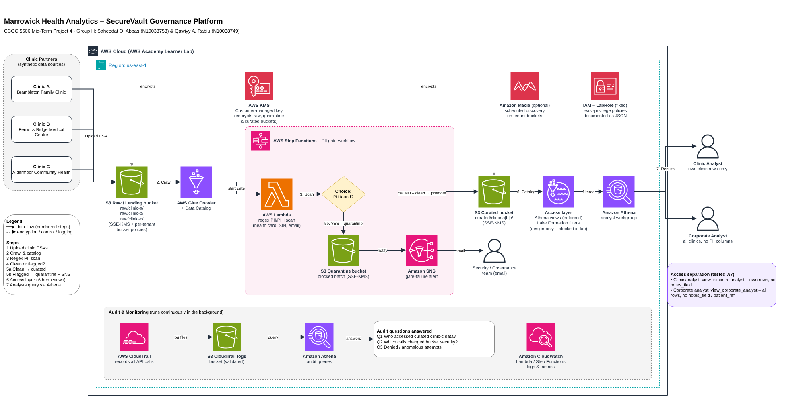

<!--
Project 4 – Marrowick Health Analytics (CCGC 5506, Humber, Fall 2026)
Group H: Qawiyy A. Rabiu (N10038749), Saheedat O. Abbas (N10038753)
File: README.md – Project overview and reproduction guide
-->

# Marrowick Health Analytics – SecureVault Governance Platform

> **Demo video:** [Download the 8-minute demo (MP4, 148 MB)](https://github.com/Korweey/marrowick-securevault/raw/main/evidence/week3/group-h-marrowick-demo.mp4). GitHub can't play videos this large in the browser, so it downloads and plays in any video player.

**CCGC 5506 Mid-Term · Project 4 · Humber Polytechnic, Fall 2026**
**Group H:** Qawiyy A. Rabiu (N10038749) · Saheedat O. Abbas (N10038753)

Governance, security and compliance guardrails for a **multi-tenant health-analytics data lake** on AWS, built and tested in an AWS Academy Learner Lab. Three fictional clinics send encounter data; the platform encrypts it, keeps each clinic's data separate, **blocks any batch containing PII/PHI** from reaching the analytics zone, restricts what each analyst role can see, and keeps an auditable trail of every access.

> ⚠️ **All data is synthetic.** Names, health-card numbers, SINs, emails and addresses are fabricated test fixtures.



## Results at a glance
| Control | Result | Evidence |
|---|---|---|
| Encryption at rest | SSE-KMS with customer-managed key on all tenant buckets; annual rotation | `evidence/week1/02–07` |
| Encryption enforcement | Upload requesting SSE-S3 **denied** by bucket policy | `evidence/week1/19–20` |
| PII/PHI gate | 3 raw batches **blocked** + SNS alert; 3 redacted batches **promoted**; **14/14 seeded rows caught (precision 1.00, recall 1.00)** | `evidence/week2/07–30` |
| Tenant & column separation | **7/7** restricted-query tests passed (0 rows / COLUMN_NOT_FOUND) | `evidence/week2/38–46` |
| Audit trail | 3 audit questions answered from CloudTrail via Athena | `evidence/week2/48–54` |

## Architecture
```
Clinic CSVs ─▶ S3 raw/clinic-x/ (SSE-KMS, bucket policies)
                   │
                   ▼
        Step Functions: marrowick-pii-gate
          ScanForPII (Lambda regex) ─▶ PIIDetected?
             ├─ yes ─▶ copy to S3 quarantine ─▶ SNS email ─▶ FAIL (blocked)
             └─ no  ─▶ copy to S3 curated ───────────────▶ SUCCEED
                   │
                   ▼
        Glue crawler ─▶ Data Catalog ─▶ Athena views (clinic / corporate) ─▶ analysts
CloudTrail (mgmt + scoped S3 data events) ─▶ S3 logs ─▶ Athena audit queries
```
Editable diagram: [`architecture/Marrowick_Architecture.drawio`](architecture/Marrowick_Architecture.drawio)

## Repository layout
| Path | Contents |
|---|---|
| `architecture/` | draw.io diagram, PNG preview, script that generates it |
| `data/raw/` | Clinic CSVs as uploaded (answer-key column removed) |
| `data/remediated/` | Steward-redacted `_v2` files that pass the gate |
| `src/lambda/pii_scan.py` | Regex PII/PHI scanner (Lambda) |
| `src/stepfunctions/pii_gate.asl.json` | Quarantine-or-promote workflow |
| `src/lambda/analyst_query.py` | Test harness for Lake Formation grants (not used – LF blocked) |
| `sql/` | Access views, access tests, CloudTrail audit queries |
| `iam/` | KMS key policy, bucket policies (deployed), role policies (design-only) – see `iam/README.md` |
| `lakeformation/permission-matrix.md` | Lake Formation design (design-only) |
| `tests/` | Offline scanner test + answer key |
| `docs/` | Compliance mapping, incident-response runbook, teamwork, weekly progress logs |
| `evidence/` | Screenshots per week (`issues/` = problems hit and fixed) |

## Reproduce from a fresh Learner Lab session (~60–90 min)
Replace `004716017211` with your account ID everywhere (bucket names, ARNs in JSON/ASL files). Region **us-east-1**.

1. **Offline check (optional):** `python3 tests/test_pii_scan.py` → expect `TP=14 FP=0 FN=0`.
2. **KMS:** create symmetric key `marrowick-data-key`; paste `iam/kms-key-policy.json` as the key policy; enable automatic rotation (365 days).
3. **S3:** create `marrowick-raw-<acct>`, `marrowick-quarantine-<acct>`, `marrowick-curated-<acct>` – block public access, versioning off, **SSE-KMS with the key above, Bucket Key on**. Create `clinic-a/`, `clinic-b/`, `clinic-c/` in each. Apply `iam/bucket-policy-<zone>.json` to each.
4. **CloudTrail:** trail `marrowick-audit-trail`, new log bucket, log-file validation on; management events all; data events → S3 → *Custom* selector `resources.ARN startsWith` the three bucket ARNs (with trailing `/`).
5. **Upload:** `data/raw/clinic-x_encounters.csv` → `raw/clinic-x/` (default encryption – don't override).
6. **SNS:** standard topic `marrowick-pii-gate-alerts`; email subscription; **confirm** the email.
7. **Lambda:** `marrowick-pii-scan`, Python 3.12, role **LabRole**, code = `src/lambda/pii_scan.py`, timeout 30 s.
8. **Step Functions:** Standard state machine `marrowick-pii-gate`, definition = `src/stepfunctions/pii_gate.asl.json`, execution role **LabRole**.
9. **Run the gate** for each clinic with input `{"bucket":"marrowick-raw-<acct>","key":"clinic-a/clinic-a_encounters.csv"}` → expect **Failed / PIIDetected** + email. Then upload `data/remediated/*_v2_redacted.csv` to raw and run again → expect **Succeeded**, file in curated.
10. **Glue:** database `marrowick_curated`; crawler on `s3://marrowick-curated-<acct>/` with LabRole → one table, 615 rows.
11. **Athena:** results bucket `marrowick-athena-results-<acct>`; run `sql/01_access_views.sql`, then each test in `sql/02_access_tests.sql`.
12. **Audit:** run `sql/03_cloudtrail_audit.sql` statement by statement (update the CloudTrail bucket name and date range).

**Cleanup / cost:** Everything is serverless and pay-per-use. The KMS key (~US$1/month) and tiny S3 objects are the only standing costs; delete buckets and schedule key deletion after grading.

## Learner Lab limitations (and what we did instead)
| Blocked | Impact | Our response |
|---|---|---|
| IAM role/user creation | No per-service or per-analyst roles | All services ran as LabRole; least-privilege policies written as design-only JSON (`iam/roles/`) |
| Lake Formation (`GetDataLakeSettings` denied) | No row/column filters on the table | Equivalent Athena views, tested 7/7; full LF design in `lakeformation/` |
| Tagged principals | Bucket-policy tenant statements can't be exercised | Deployed for production readiness; documented as untestable |

Views are a weaker control than Lake Formation (anyone who can read the base table can bypass them); this is stated in the compliance mapping as a residual risk.

## Documentation
- [Compliance mapping (PIPEDA-style)](docs/compliance-mapping.md)
- [Incident-response runbook](docs/incident-response-runbook.md)
- [IAM policy set & deployability](iam/README.md)
- [Team technical report & contributions](docs/teamwork.md)
- Weekly logs: [Week 1](docs/progress/week1-progress.md) · [Week 2](docs/progress/week2-progress.md) · [Week 3](docs/progress/week3-progress.md)

## Team
| Member | ID | Role |
|---|---|---|
| Qawiyy A. Rabiu | N10038749 | **Cloud Security Engineer (Build & Deployment)** – developed the code (with AI-assisted drafting) and deployed the platform |
| Saheedat O. Abbas | N10038753 | **Security Test & Compliance Analyst** – ran the control tests and analysed the results |

See [`docs/teamwork.md`](docs/teamwork.md) for the detailed contribution record.
